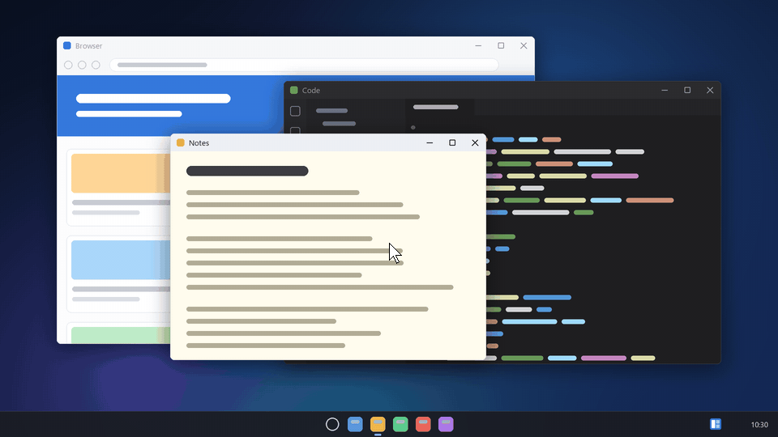
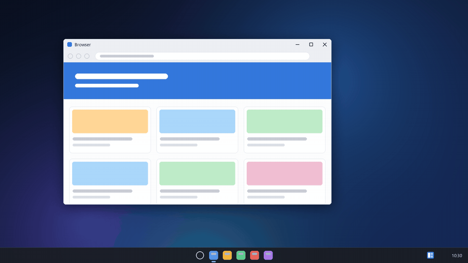
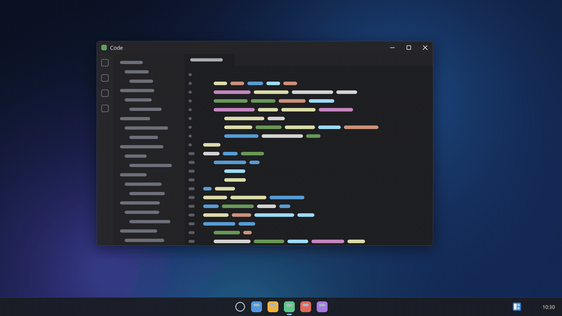
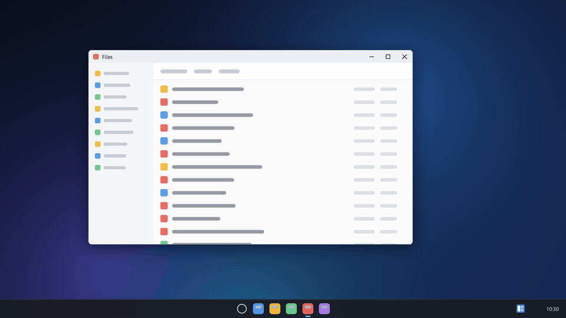
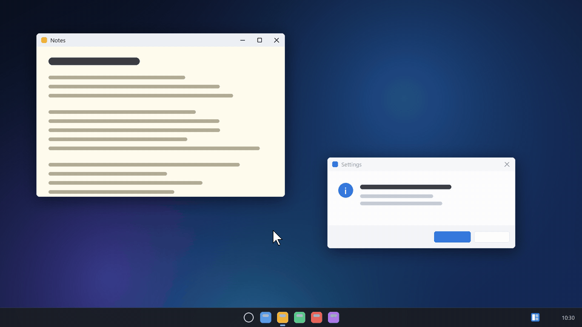
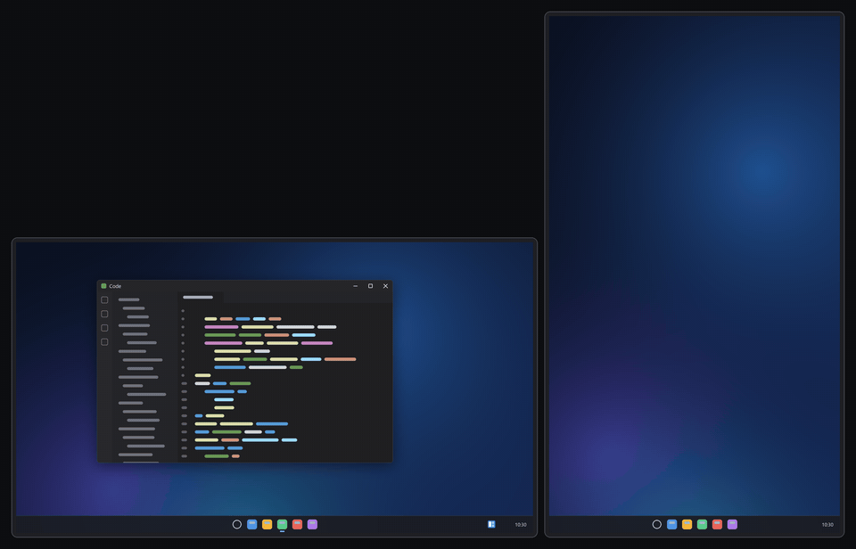
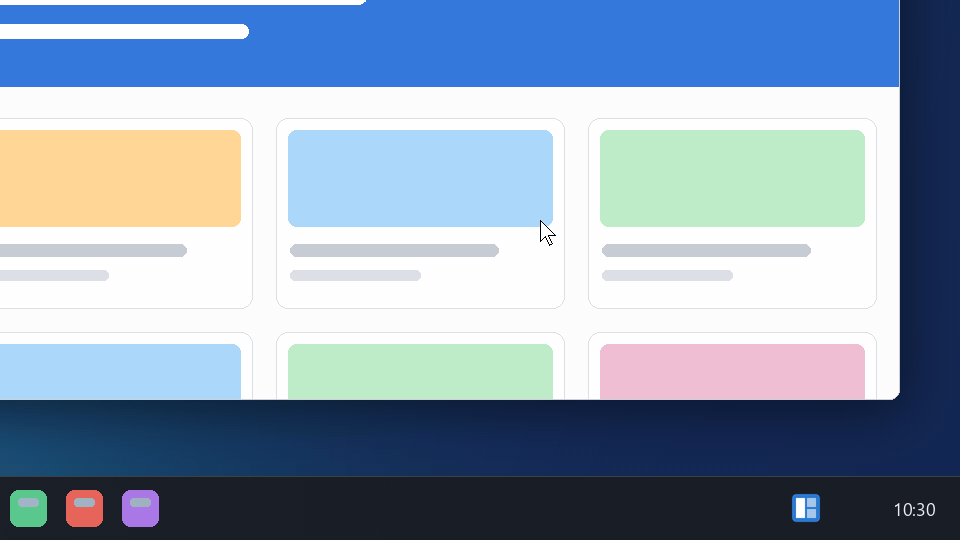
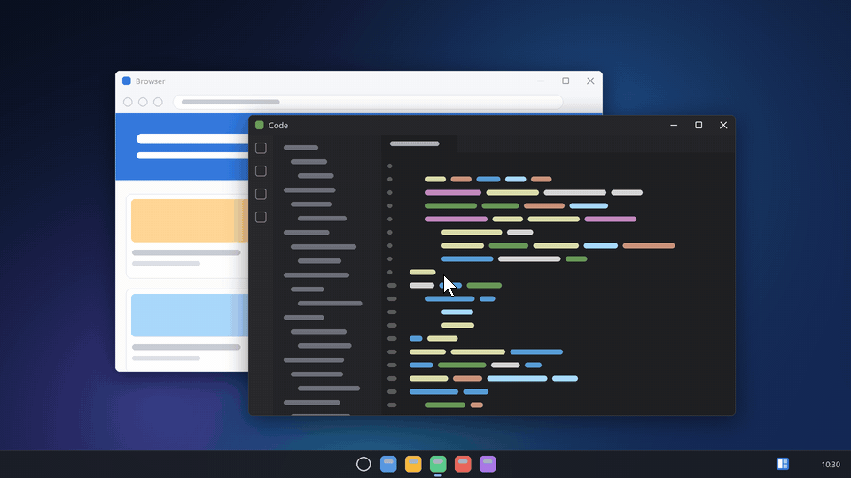
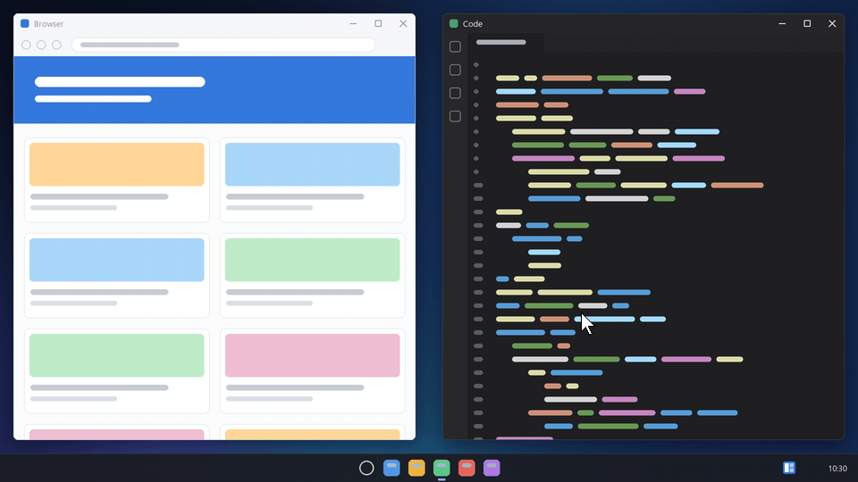

<div align="center">


<p>
  <a href="https://github.com/6up3r/windowfit/releases/latest"></a>
  <a href="https://github.com/6up3r/windowfit/releases"></a>
  
  <a href="https://github.com/6up3r/windowfit/actions/workflows/build.yml"></a>
  <a href="LICENSE"></a>
</p>

<b>Win+arrow, with room to breathe.</b><br>
Halves, quarters and the whole screen, on the monitor the window sits on, with an even gap around it.

<p>
  <a href="#-download"><b>Download</b></a> ·
  <a href="#-what-it-does"><b>What it does</b></a> ·
  <a href="#-keys"><b>Keys</b></a> ·
  <a href="#-a-tour"><b>Tour</b></a> ·
  <a href="#-install"><b>Install</b></a> ·
  <a href="#-faq"><b>FAQ</b></a> ·
  <a href="#-license"><b>License</b></a>
</p>



</div>

## ✨ What it does

<table>
  <tr>
    <td align="center" width="33%"><h3>🎹 Win+arrow</h3>Sixteen chords replace Windows Snap: halves, quarters, the whole screen, or just centred. Win+Shift+arrow stays the Windows one.</td>
    <td align="center" width="33%"><h3>📐 Even gaps</h3>The gap is a share of the screen's shorter side, the same on every side of every tile. Add <b>Ctrl</b> to go edge to edge.</td>
    <td align="center" width="33%"><h3>🔐 Every window</h3>It runs with administrator rights from a sign-in task, so it also moves windows started as administrator: Task Manager, elevated terminals.</td>
  </tr>
</table>

Windows tiled together form a **group**: bring one back to the front and the others come back with it.

It **updates itself**, on your click: a new release shows its notes first, and only a setup signed with windowfit's release key is ever run.

Nothing to configure: keys and gaps are fixed. It lives in the notification area, writes no log and needs no PowerToys.

## 🎹 Keys

| Keys | Effect |
|---|---|
| Win+Left / Win+Right | left / right half, with a gap |
| Win+Up | half-width box, centred, with a gap |
| Win+Down | centres the window without resizing it |
| Win+Ctrl+Left / Win+Ctrl+Right | left / right half, edge to edge |
| Win+Ctrl+Up | the whole screen, edge to edge (taskbar excluded) |
| Win+Ctrl+Down | the whole screen with a wide gap, wider at the sides |
| Win+Up+Left / Win+Up+Right | top-left / top-right quarter, with a gap |
| Win+Down+Left / Win+Down+Right | bottom-left / bottom-right quarter, with a gap |
| Win+Ctrl+two arrows | the same quarter, edge to edge |

For a quarter, hold one arrow and press the perpendicular one, in either order: the window first makes the first arrow's move and right after goes to the quarter.

While windowfit runs, Win+Ctrl+Left/Right fit the window instead of switching virtual desktops.

## 🎬 A tour

<table>
  <tr>
    <td width="50%"></td>
    <td width="50%"><h3>Halves with a gap</h3><b>Win+Left</b> and <b>Win+Right</b> fit the window to a half, <b>Win+Up</b> to a half-width box in the middle. The gap is 3% of the screen's shorter side, on all four sides.</td>
  </tr>
  <tr>
    <td width="50%"><h3>Quarters, in either order</h3>Hold one arrow and press the perpendicular one: <b>Up</b> then <b>Left</b>, or <b>Left</b> then <b>Up</b>, both end in the top-left quarter.</td>
    <td width="50%"></td>
  </tr>
  <tr>
    <td width="50%"></td>
    <td width="50%"><h3>Edge to edge with Ctrl</h3><b>Ctrl</b> drops the gap: halves, quarters and the whole screen without the taskbar. <b>Win+Ctrl+Down</b> goes the other way: the whole screen with a wide gap, wider at the sides.</td>
  </tr>
  <tr>
    <td width="50%"><h3>Centre, keep the size</h3><b>Win+Down</b> centres the window as it is. A window that cannot be resized, such as a fixed-size dialog, is left alone by the other chords and is still centred by Win+Down.</td>
    <td width="50%"></td>
  </tr>
  <tr>
    <td width="50%"></td>
    <td width="50%"><h3>On the monitor it sits on</h3>Every chord works on the monitor that holds the window, inside its work area and with its own gap. <b>Win+Shift+arrow</b> is still Windows' move to the next monitor.</td>
  </tr>
  <tr>
    <td width="50%"><h3>Pause from the tray</h3>Untick <b>Enabled</b> in the icon's menu, or double-click the icon: it turns grey and Win+arrow is Windows Snap again. Tick it, or double-click again, to take the keys back.</td>
    <td width="50%"></td>
  </tr>
  <tr>
    <td width="50%"></td>
    <td width="50%"><h3>Groups come back together</h3>Windows you tile side by side on a monitor form a group. When another app covers them, activate any one of them (taskbar, Alt+Tab, a click) and the others come back right beneath it, without taking the focus. Several groups can share a monitor: a window put where another already sits starts a new one.</td>
  </tr>
  <tr>
    <td width="50%"><h3>Updates that ask first</h3>When a new release is out, a notification says so and the menu gains <b>Install update</b>: it shows the release's notes, signed with it. <b>Install</b> checks the setup against that signature and runs it with only a progress bar; windowfit comes back on its own and <b>What's new</b> opens once.</td>
    <td width="50%"></td>
  </tr>
</table>

<sub>The animations are drawn, not recorded: the window positions are computed by windowfit's own code.</sub>

## 📦 Download

One setup per kind of Windows, all in the [latest release](https://github.com/6up3r/windowfit/releases/latest):

| Your Windows | Download |
| --- | --- |
| **Windows 11 or 10, 64-bit** (most PCs) | [**windowfit-setup-x64.exe**](https://github.com/6up3r/windowfit/releases/latest/download/windowfit-setup-x64.exe) |
| **Windows 11 on ARM** (Snapdragon) | [**windowfit-setup-arm64.exe**](https://github.com/6up3r/windowfit/releases/latest/download/windowfit-setup-arm64.exe) |
| **Windows 10, 32-bit** | [**windowfit-setup-x86.exe**](https://github.com/6up3r/windowfit/releases/latest/download/windowfit-setup-x86.exe) |

<details>
<summary><b>Not sure which file you need?</b></summary>
<br>

**Settings > System > About**, «System type»: «64-bit operating system, x64-based processor» takes `x64`, «ARM-based processor» `arm64`, «32-bit operating system» `x86`. A setup started on the wrong kind of Windows says which one to download.
</details>

<details>
<summary><b>Check the download</b></summary>
<br>

The `.sha256` file next to each setup holds its hash. In PowerShell, `(Get-FileHash windowfit-setup-x64.exe).Hash` must give the same value, ignoring case.
</details>

> [!NOTE]
> The setup is not signed: Windows may show the SmartScreen warning «Windows protected your PC». Click **More info**, then **Run anyway**.

**Requirements:** Windows 11 or Windows 10, in a version supported by .NET 10, and an administrator account or an administrator's password to install. Nothing else: the .NET runtime is inside the exe.

## 🧰 Install

Run the setup and confirm the administrator prompt. The wizard follows the Windows display language (English, Italian, German, French, Spanish, Portuguese, Dutch, Polish, Russian, Japanese, Chinese, Korean, Turkish) and asks who uses windowfit:

- **Only for me**: windowfit starts when you sign in;
- **For all users of this PC**: it starts for anyone who signs in; on standard accounts it runs without administrator rights, so it cannot move windows started as administrator.

The setup installs windowfit in `C:\Program Files\windowfit` and creates the scheduled task `\windowfit\windowfit`, which starts it at sign-in with administrator rights without asking (through `windowfit-launcher.exe`, which leaves out the environment variables any program of your account could set to slip code into it), and a **windowfit** entry in the Start menu. If PowerToys FancyZones is set to override Windows Snap, the wizard says so: the two would compete for the same keys.

Running a newer setup over an installed windowfit updates it and keeps the choice made at install. `/VERYSILENT /SCOPE=all` installs for all users without the wizard.

### Updates

windowfit looks for a new release a couple of minutes after it starts and then once a day. When one is out, a notification says so and the menu gains **Install update X.Y.Z...**: it shows what the release changes, and **Install** downloads its setup, checks it against the release's signature and runs it with only a progress window; windowfit then starts again with the same install choice, and **What's new** opens once. Nothing is installed without that click, and only a setup signed with windowfit's release key is ever run. With **For all users**, an update closes windowfit for everyone signed in; the others get it back at their next sign-in or from the Start menu. On a standard account, where windowfit has no administrator rights, the item opens the release page instead.

The changes of every version are in [CHANGELOG.md](CHANGELOG.md).

### Use

windowfit lives in the notification area: a blue icon with a tiled window, grey while paused. Its menu, in the Windows display language:

- **Groups**: unticked, windows no longer form groups and existing groups dissolve; ticked again, new groups start forming. The choice is kept across restarts.
- **Enabled**: unticked, windowfit pauses and Win+arrow is Windows Snap again (Win+Ctrl+Left/Right switch virtual desktops); ticked, it takes the keys back. A double click on the icon does the same. Every start begins enabled.
- **Install update X.Y.Z...**: present when a newer release is out; see [Updates](#updates).
- **What's new...**: the changes of every version up to the installed one.
- **Check for updates**: looks for a new release now and says what it found.
- **License...**: windowfit's license (Copyright (c) 2026 6Up3r, MIT) and the third-party notices.
- **Exit**: closes windowfit; the **windowfit** entry in the Start menu starts it again, and so does the next sign-in.

### Status check

It changes nothing; run it from a terminal **run as administrator**:

```
powershell -NoProfile -ExecutionPolicy Bypass -File "C:\Program Files\windowfit\status.ps1"
```

Each line says `OK` or `FAIL`: installed files, task, running process with administrator rights, FancyZones option.

### Uninstall

**Settings > Apps > Installed apps > windowfit > Uninstall**. It stops windowfit and removes the task, the folder in Program Files and the Start menu entry; Win+arrow goes back to Windows Snap.

## ❓ FAQ

<details>
<summary><b>Win+arrow still does Windows Snap</b></summary>
<br>
windowfit is paused (grey icon: double-click it) or not running (start <b>windowfit</b> from the Start menu). If that does not help, run the status check or run the setup again.
</details>

<details>
<summary><b>The Start menu opens after Win+arrow</b></summary>
<br>
Open an issue in this repository; if you can, attach the log lines of the Debug build (see <a href="#-build-from-source">Build from source</a>).
</details>

<details>
<summary><b>Does it work with PowerToys FancyZones?</b></summary>
<br>
Yes, as long as FancyZones' «Override Windows Snap» option stays off; otherwise the two programs fight over the same keys. The setup and the status check look at it.
</details>

<details>
<summary><b>Which windows does it leave alone?</b></summary>
<br>
Minimized and fullscreen windows (games, videos), tool windows, the desktop and the taskbar. Windows that cannot be resized, such as fixed-size dialogs, are only centred by Win+Down. A maximized window is restored first, then fitted.
</details>

<details>
<summary><b>How do groups form?</b></summary>
<br>
A window placed with windowfit stays with its companions when its new place does not clash with theirs, otherwise it joins the monitor's most recent group if there is room, otherwise it starts a new group; two groups that no longer clash become one. Two places clash when they are the same or one contains the other (a half and a quarter on the same side, the whole screen and anything): left half, centred half and right half can therefore share a group, and a group holds at most five windows.
</details>

<details>
<summary><b>How do I take a window out of its group?</b></summary>
<br>
Move or resize it with the mouse, put it with windowfit where it clashes with a companion, centre it with Win+Down, send it to the whole screen, carry it to another monitor or virtual desktop, minimize it or close it. Show desktop (Win+D) and minimize all (Win+M) keep the groups.
</details>

<details>
<summary><b>Why does it run with administrator rights?</b></summary>
<br>
Windows does not let a normal program see the keys sent to a window started as administrator, nor move it. The sign-in task starts windowfit with administrator rights without a prompt; its folder in Program Files is writable only by administrators.
</details>

<details>
<summary><b>Can I change the keys or the gap?</b></summary>
<br>
No: there is nothing to configure besides the tray's Groups switch. The gap is 3% of the screen's shorter side, and Win+Ctrl+Down uses 9% at the top and bottom and 18% at the sides.
</details>

## 🧱 Build from source

Requires .NET SDK 10.0.402 or a later 10.0 version (`global.json` pins the SDK). From the repo folder:

```
dotnet build -c Release
dotnet test
```

To try it without installing, start `src\WindowFit\bin\Release\net10.0-windows\windowfit.exe` from a normal terminal: it takes Win+arrow at once and closes from **Exit** in the icon's menu. Started this way it has no administrator rights: on windows started as administrator Win+arrow stays Windows Snap. A build without `-p:Version` is version 0.0.0 and never looks for updates.

To build the setups, install [Inno Setup 6](https://jrsoftware.org/isinfo.php) and the Visual Studio Build Tools with the C++ x64/x86 and ARM64 tools, then publish, build the launcher and run the setup compiler (`Arch` is `x64`, `x86` or `arm64`):

```
dotnet publish src\WindowFit\WindowFit.csproj -c Release -r win-x64 --self-contained true -o out\x64
powershell -NoProfile -ExecutionPolicy Bypass -File installer\build-launcher.ps1 -Arch x64 -OutDir out\launcher-x64
ISCC /DArch=x64 /DAppVersion=1.0.0 /DSourceExe=%CD%\out\x64\windowfit.exe /DLauncherExe=%CD%\out\launcher-x64\windowfit-launcher.exe installer\windowfit.iss
```

The setup lands in `installer\Output\`.

The Release build, the installed one included, writes no log. For a diagnosis use the Debug build: `dotnet build`, then start `src\WindowFit\bin\Debug\net10.0-windows\windowfit.exe`. It writes to `%LOCALAPPDATA%\windowfit\windowfit.log` the ignored windows, those that did not reach the exact position and the errors, and its menu also has **Open log**.

The technical notes for agents are in `AGENTS.md`.

## 📜 License

windowfit is Copyright (c) 2026 [6Up3r](https://github.com/6up3r), released under the [MIT License](LICENSE).

It carries or is built with these third-party works, each under its own license:

| Work | Copyright | License | In |
|---|---|---|---|
| [.NET Runtime](https://github.com/dotnet/runtime) 10.0 | .NET Foundation and Contributors | MIT | `windowfit.exe` |
| [Windows Forms](https://github.com/dotnet/winforms) 10.0 | .NET Foundation and Contributors | MIT | `windowfit.exe` |
| [Inno Setup](https://jrsoftware.org/isinfo.php) 6 | Jordan Russell; portions Martijn Laan | Inno Setup License | the setups |
| Inno Setup's Chinese (Simplified) translation | maintained by Zhenghan Yang | Inno Setup License | the setups |

Their full texts are in [`THIRD-PARTY-NOTICES.txt`](THIRD-PARTY-NOTICES.txt), and in **License...** in the tray icon's menu.

## Credits

windowfit started as a fork of a Linux script developed by [MatrixDJ96](https://github.com/MatrixDJ96).

<div align="center">
<br>
<sub>Made by <a href="https://github.com/6up3r"><b>6Up3r</b></a> · Copyright (c) 2026 6Up3r · <a href="LICENSE">MIT License</a></sub>
</div>
